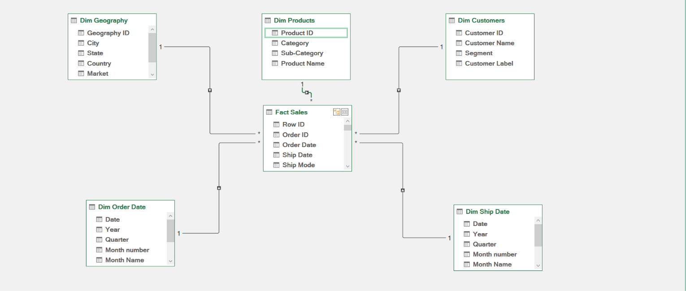
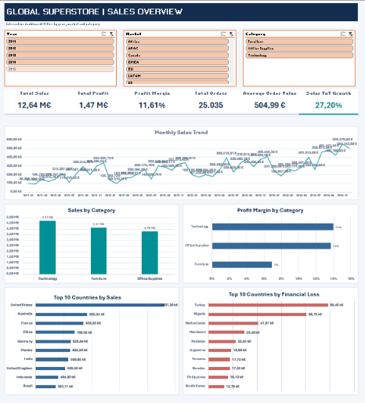
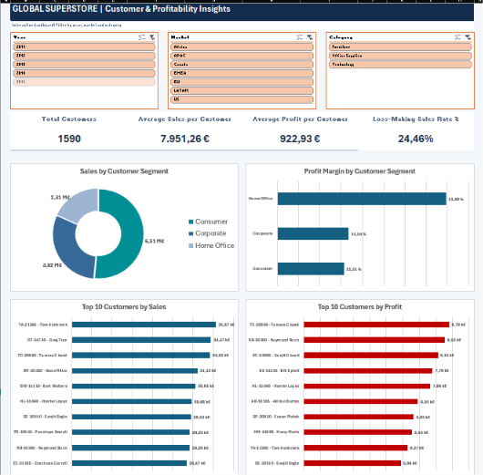

# Global Superstore | Excel Business Intelligence Project

## Project Overview

This project presents an end-to-end Business Intelligence analysis of the Global Superstore dataset using **Microsoft Excel, Power Query, Power Pivot, and DAX**.

The objective is to transform raw sales data into a structured analytical model, evaluate business performance, identify profitability issues, and develop interactive dashboards to support data-driven decision-making.

## Tools & Technologies

- **Microsoft Excel** — Interactive dashboards and PivotTables
- **Power Query** — Data cleaning, transformation, and preparation
- **Power Pivot** — Data modeling and relationship management
- **DAX** — Business measures and KPI calculations
- **GitHub** — Project documentation and portfolio

## Dataset

The dataset contains 51,290 sales records covering the period from 2011 to 2014.

It includes information about orders, customers, products, geographic markets, sales, discounts, and profits.

**Data granularity:** One row represents one product line within an order.

## Data Preparation — Power Query

The raw dataset was transformed into a structured analytical model.

Main preparation steps included:

- Checking and removing duplicate records.
- Validating data types and handling missing values.
- Creating dimension tables from the original dataset.
- Generating a calendar table.
- Creating separate order-date and shipping-date dimensions.
- Preparing a fact table containing transactional sales data.
- Building geographic identifiers to establish relationships between sales and locations.

## Data Modeling — Power Pivot

A star schema was developed to organize the analytical data.

**Fact table:**
- Fact Sales

**Dimension tables:**
- Dim Customers
- Dim Products
- Dim Geography
- Dim Order Date
- Dim Ship Date

Relationships were created between the fact table and each dimension using a one-to-many structure.



## DAX Measures & KPIs

Custom DAX measures were created to evaluate sales performance, profitability, customer behavior, and financial losses.

Key measures include:

- Total Sales
- Total Profit
- Profit Margin %
- Total Orders
- Total Quantity
- Average Order Value
- Average Selling Price
- Sales YoY Growth %
- Profit YoY Growth %
- Total Customers
- Average Sales per Customer
- Average Profit per Customer
- Loss-Making Sales
- Loss-Making Sales Rate %

Time-intelligence calculations were also implemented to compare annual performance.

## Dashboard 1 — Sales Overview

This dashboard provides an overview of business performance through:

- Sales, profit, margin, orders, and growth KPIs.
- Monthly sales trends.
- Sales and profit margins by product category.
- Top 10 countries by sales.
- Top 10 countries by financial losses.

Interactive slicers allow users to filter results by **Year, Market, and Category**.



## Dashboard 2 — Customer & Profitability Insights

This dashboard focuses on customer performance and profitability.

It includes:

- Total Customers.
- Average Sales per Customer.
- Average Profit per Customer.
- Loss-Making Sales Rate.
- Sales distribution by customer segment.
- Profit Margin by Customer Segment.
- Top 10 Customers by Sales.
- Top 10 Customers by Profit.

The dashboard also includes interactive Year, Market, and Category slicers.



## Key Business Insights

### 1. Overall Business Performance

Across the 2011–2014 period:

- **Total Sales:** €12.64 million
- **Total Profit:** €1.47 million
- **Profit Margin:** 11.61%
- **Total Orders:** 25,035

### 2. Sales Growth

Annual sales increased from approximately €2.26 million in 2011 to €4.30 million in 2014.

Sales growth in 2014 reached approximately **26.25% compared with 2013**.

### 3. Product Category Performance

Technology generated the highest revenue and profit among the three product categories.

Furniture recorded a substantially lower profit margin, suggesting opportunities to investigate pricing, discounting, and product profitability.

### 4. Geographic Profitability

Certain countries generated significant financial losses despite overall company profitability.

Turkey and Nigeria were among the countries with the largest cumulative losses.

These markets warrant further investigation to identify the underlying causes.

### 5. Customer Profitability

Customer segments displayed relatively similar profit margins.

Home Office recorded the highest overall margin, although the difference between segments was limited.

Approximately **24.46% of sales lines generated negative profit**, highlighting the importance of monitoring unprofitable transactions.

## Project Structure

```text
Global-Superstore-Excel-BI/
├── excel/
│   └── projet global superstore.xlsx
├── Images/
│   ├── Overview.png
│   ├── Customer.png
│   └── Star_schema.png
└── README.md
```

## Conclusion

This project demonstrates the practical application of Business Intelligence principles using the Excel ecosystem.

It covers the complete analytical workflow: data preparation, dimensional modeling, DAX calculations, business analysis, and interactive dashboard development.

The resulting dashboards provide actionable insights into sales growth, customer performance, product profitability, and geographic financial risks.
